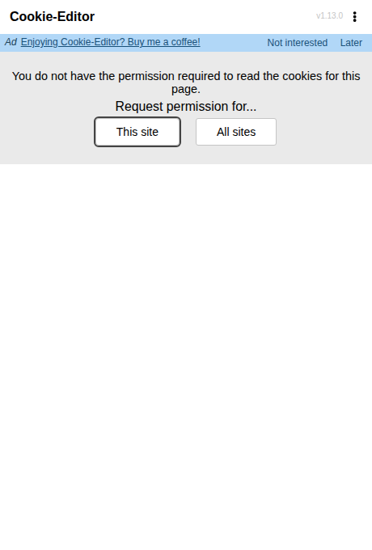
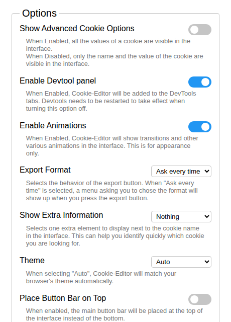

# Cookie-Editor for Brave — Official v1.13.0 Build

The **official Cookie-Editor** (from [cookie-editor.com](https://cookie-editor.com)) packaged ready for **Brave**: download, load unpacked, done. No code changes — this is the project's own Chrome build, and Brave runs Chromium builds natively.

> **Credit:** Cookie-Editor is created by **Moustachauve** (Christophe Gagnier) and released under **GPL-3.0**. Upstream source: [github.com/Moustachauve/cookie-editor](https://github.com/Moustachauve/cookie-editor). This repository simply hosts the official v1.13.0 Chrome build in load-unpacked form for Brave users, with the license preserved.

## Screenshots

**Popup — toolbar interface (first run, before site access is granted):**

**Options — advanced settings, DevTools panel, export format, themes:**

## Install in Brave (one time, ~1 minute)

1. Download this repository (Code → Download ZIP) and unzip it somewhere permanent, or clone it:
   `git clone https://github.com/jonyhossan110/cookie-editor-brave.git`
   Keep the folder — Brave loads the extension from it.
2. In Brave, open `brave://extensions`
3. Turn on **Developer mode** (top-right).
4. Click **Load unpacked** and select the folder that contains `manifest.json` (the repository root).
5. Pin Cookie-Editor from the puzzle-piece menu.

## First use

The first time you open Cookie-Editor on a site, it asks you to grant access to that site (or all sites). That is the official design: host access is an optional, per-site permission instead of always-on. After granting, the popup lists every cookie for the current page.

## Features

- View all cookies for the current page in the toolbar popup
- Create, edit and delete cookies (name, value, domain, path, expiry, HttpOnly, Secure, SameSite…)
- Delete all cookies for a site in two clicks
- Import / Export cookies (JSON, Netscape format, header string)
- DevTools panel and side panel interfaces
- Options: advanced cookie fields, export format, extra info, themes (light/dark/auto)
- **Privacy:** Cookie-Editor collects no data at all — everything stays in your browser

## Provenance

- Built from the official **v1.13.0** release source with the project's own Grunt pipeline, Chrome target — identical output to the build distributed for Chromium browsers.
- Verified before publishing: loaded into Chromium, service worker registered, popup and options interfaces rendered with zero errors.

## License

GPL-3.0 — see [LICENSE](LICENSE). © the Cookie-Editor contributors / Moustachauve.

---
Packaged for Brave by Md. Jony Hassain ([HexaCyberLab](https://github.com/jonyhossan110)) — packaging only; all Cookie-Editor credit belongs to its author and contributors.
